# Отчёт по развёртыванию окружения DevOps (WSL + Ubuntu + SDK + PostgreSQL)

## Цель работы

Поднять WSL (Windows Subsystem for Linux) на ПК с Windows, установить дистрибутив Ubuntu, настроить пользователя, установить SDK/компилятор (интерпретатор) и СУБД PostgreSQL. Весь процесс задокументирован скриншотами с видимой датой, временем и именем пользователя.

## Окружение

- Хост-ОС: Windows 10.0.26200.9974
- WSL: версия 2.7.10.0, ядро 6.18.33.2-2
- Дистрибутив: Ubuntu 26.04 LTS (resolute)
- Пользователь Linux: semenov-n-m
- Интерпретатор: Python 3.14.4
- Компилятор / SDK: Go 1.23.4 (linux/amd64)
- СУБД: PostgreSQL 18.6
- База данных: semenov_db, владелец semenov_n_m

## Структура репозитория

```
.
├── README.md
└── images/
    ├── 01-wsl-installed.jpg
    ├── 02-user-created.jpg
    ├── ...
    └── 18-db-roles.jpg
```

## Этап 1. WSL и пользователь Linux

### 1.1. Проверка и установка WSL

WSL уже был установлен (версия 2.7.10.0). Для чистоты эксперимента дистрибутив Ubuntu был удалён (wsl --unregister Ubuntu) и установлен заново командой wsl --install -d Ubuntu.

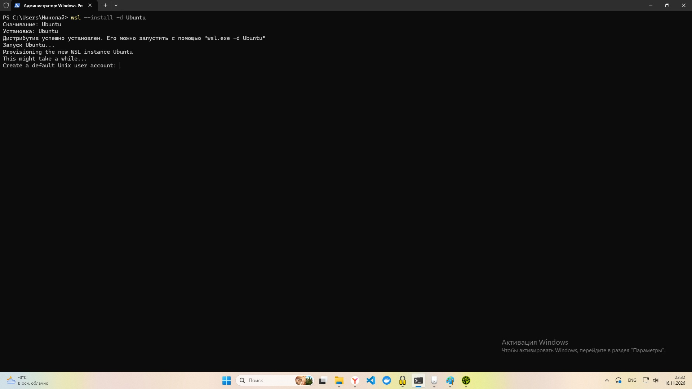

*Рис. 1. Процесс установки дистрибутива Ubuntu.*

### 1.2. Создание пользователя

При первом запуске создан пользователь semenov-n-m.

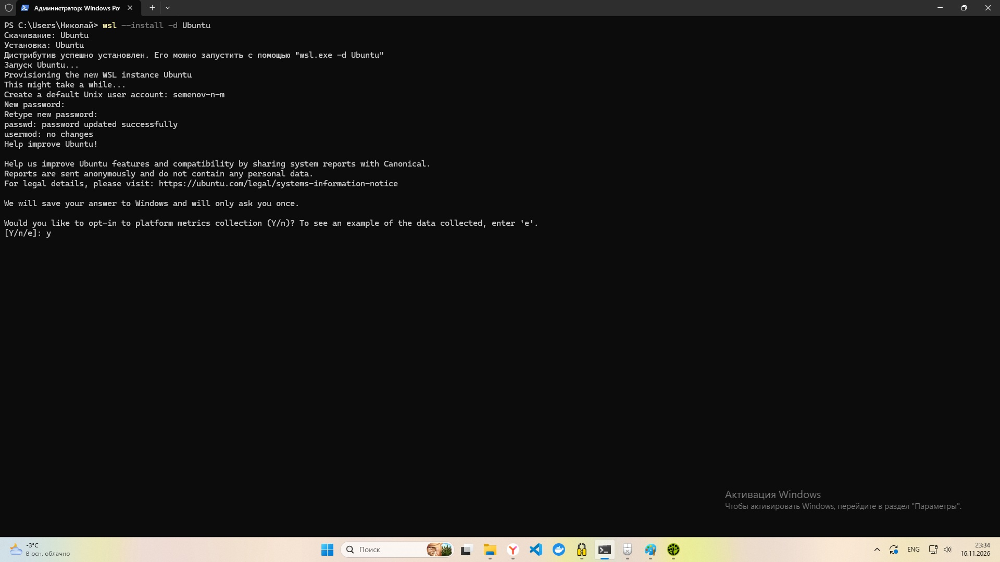

*Рис. 2. Создание пользователя semenov-n-m.*

Проверка текущего пользователя:

```bash
whoami
```

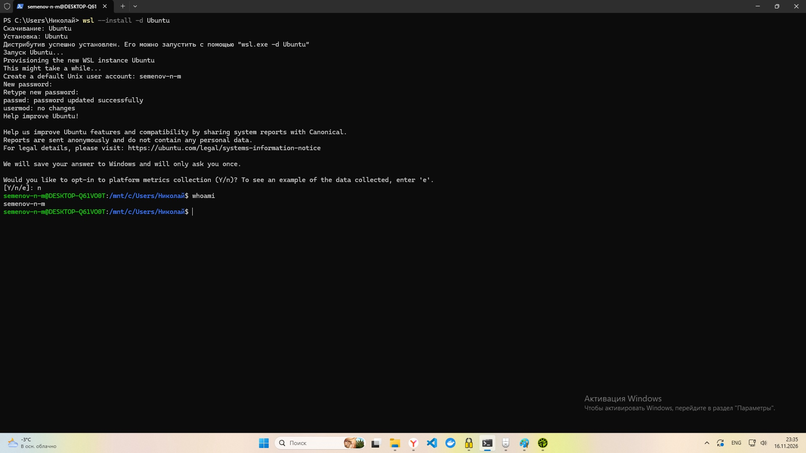

*Рис. 3. Вывод whoami — semenov-n-m.*

### 1.3. Настройка приглашения с датой и временем

Для того чтобы на всех скриншотах были видны дата и время, настроено приглашение PS1:

```bash
echo 'export PS1="\n[\d \t] \u@\h:\w\$ "' >> ~/.bashrc
source ~/.bashrc
```

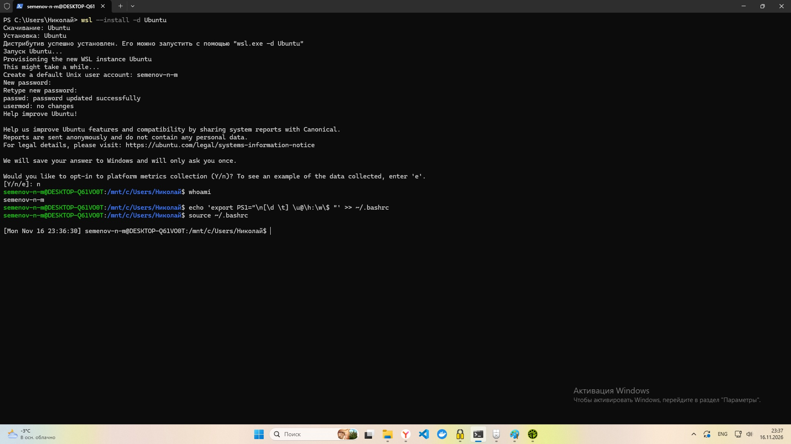

*Рис. 4. Настройка PS1 с датой и временем.*

Проверка даты и текущей директории:

```bash
date
pwd
```

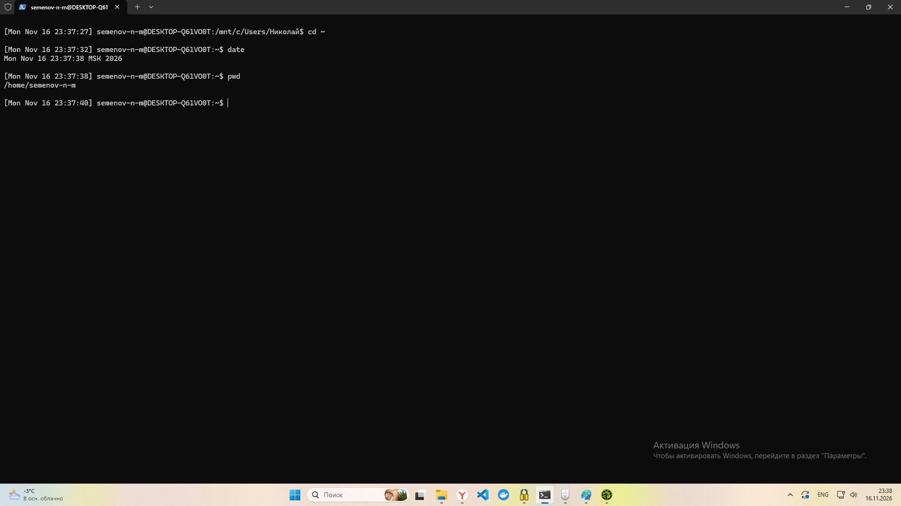

*Рис. 5. Вывод date и pwd; в приглашении видны дата, время и пользователь.*

## Этап 2. Базовые пакеты и SDK

### 2.1. Обновление системы

```bash
sudo apt update && sudo apt upgrade -y
```

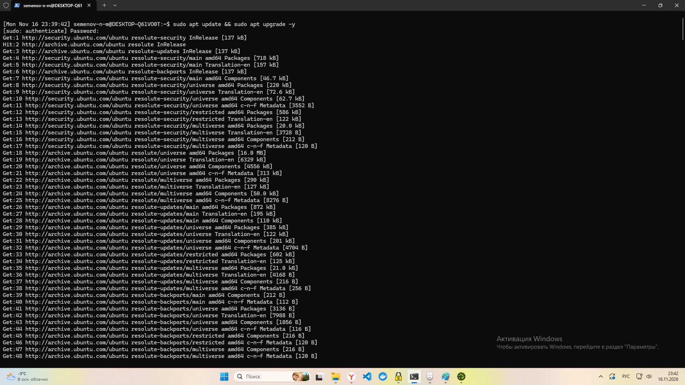

*Рис. 6. Начало обновления системы.*

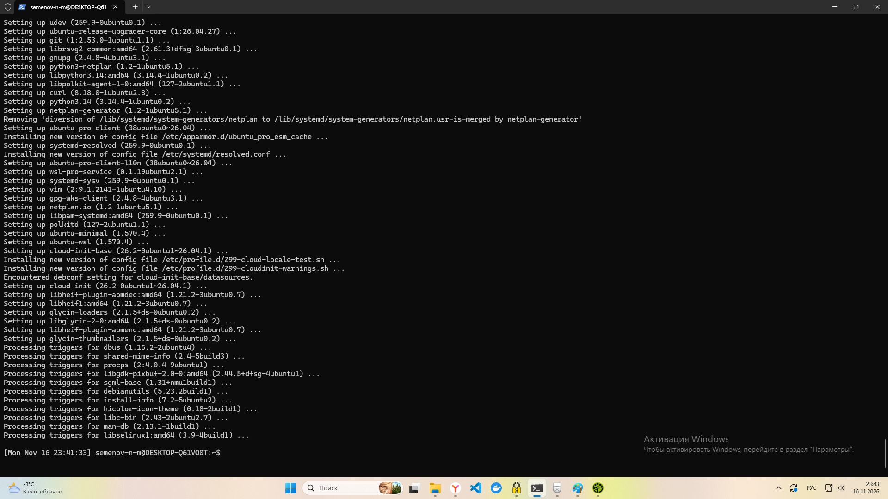

*Рис. 7. Завершение обновления системы.*

### 2.2. Интерпретатор Python

```bash
python3 --version
```

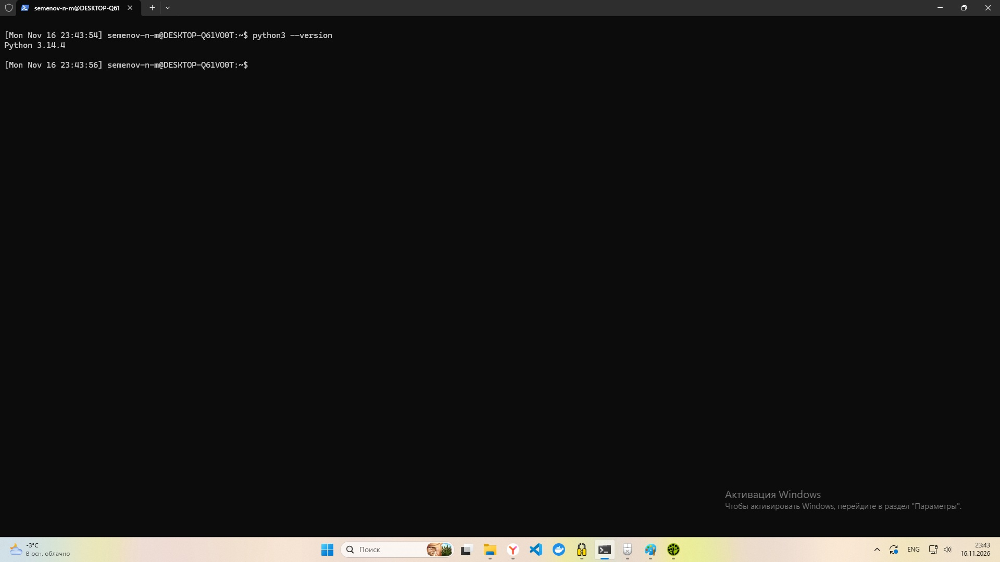

*Рис. 8. Проверка интерпретатора Python: версия 3.14.4.*

### 2.3. Компилятор и SDK Go

Скачивание официального архива Go:

```bash
wget https://go.dev/dl/go1.23.4.linux-amd64.tar.gz
```

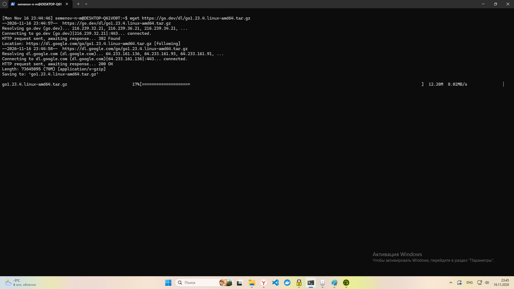

*Рис. 9. Начало скачивания архива Go.*

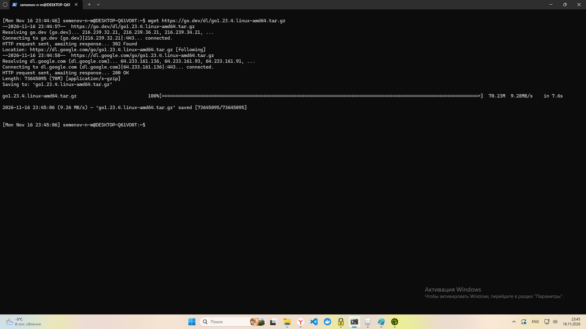

*Рис. 10. Завершение скачивания архива Go (70 МБ).*

Распаковка в /usr/local:

```bash
sudo rm -rf /usr/local/go && sudo tar -C /usr/local -xzf go1.23.4.linux-amd64.tar.gz
```

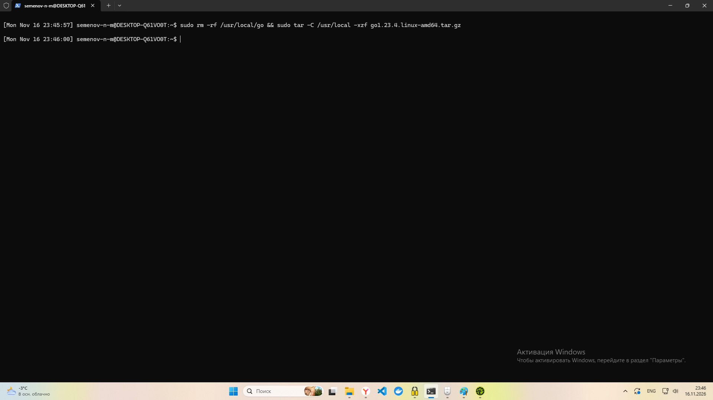

*Рис. 11. Распаковка Go в /usr/local/go.*

Настройка PATH и проверка версии:

```bash
echo 'export PATH=$PATH:/usr/local/go/bin' >> ~/.bashrc
source ~/.bashrc
go version
```

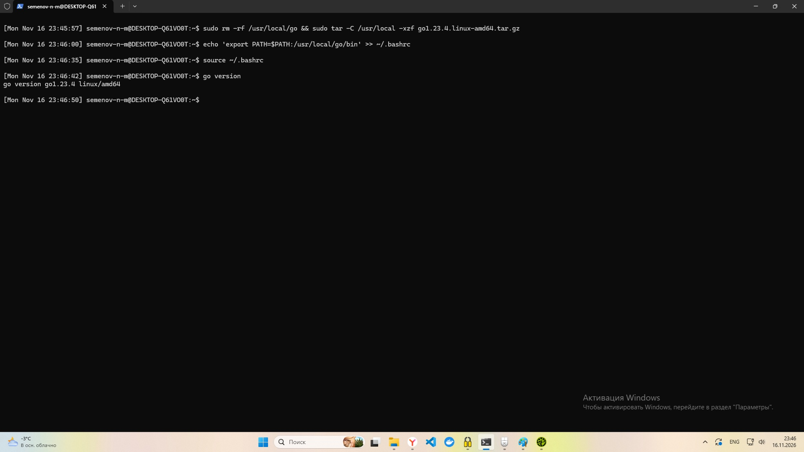

*Рис. 12. Проверка компилятора Go: go version go1.23.4 linux/amd64.*

## Этап 3. PostgreSQL

### 3.1. Установка

```bash
sudo apt install postgresql postgresql-contrib -y
```

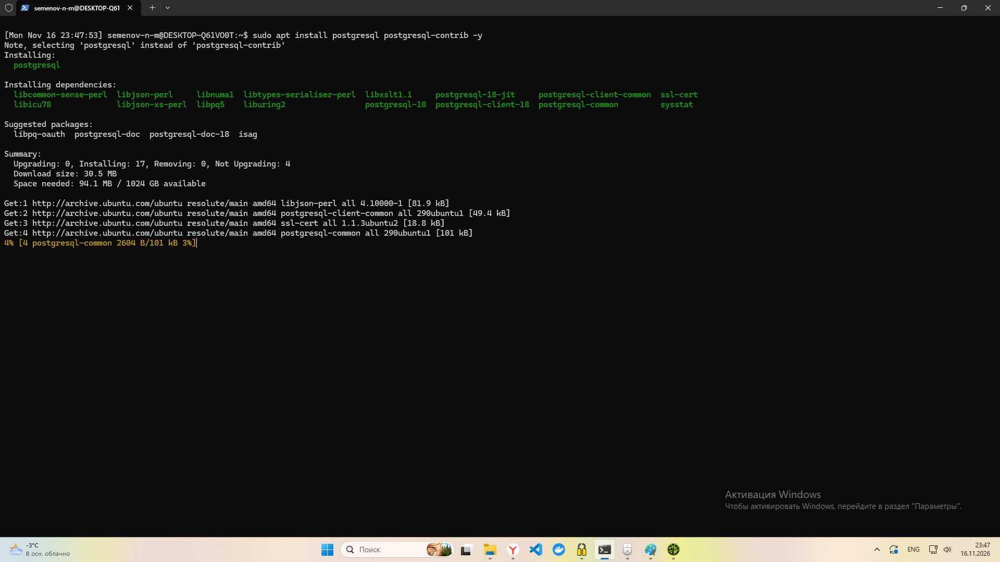

*Рис. 13. Начало установки PostgreSQL.*

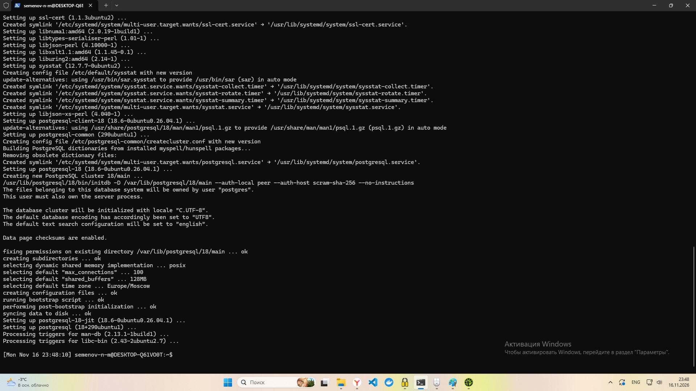

*Рис. 14. Завершение установки PostgreSQL 18.6.*

### 3.2. Проверка статуса сервиса

```bash
sudo systemctl status postgresql
```

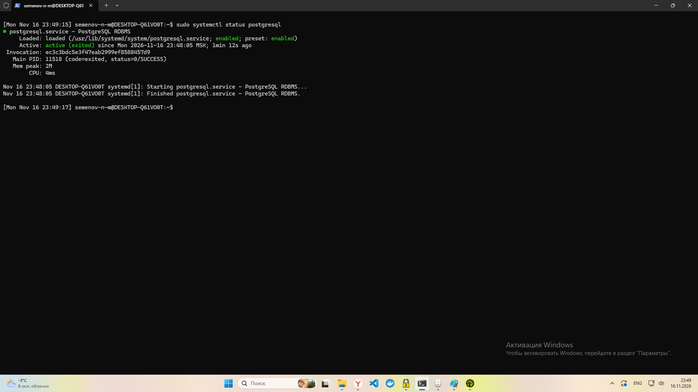

*Рис. 15. Сервис PostgreSQL активен (active (exited)).*

### 3.3. Версия клиента и список кластеров

```bash
psql --version
pg_lsclusters
```

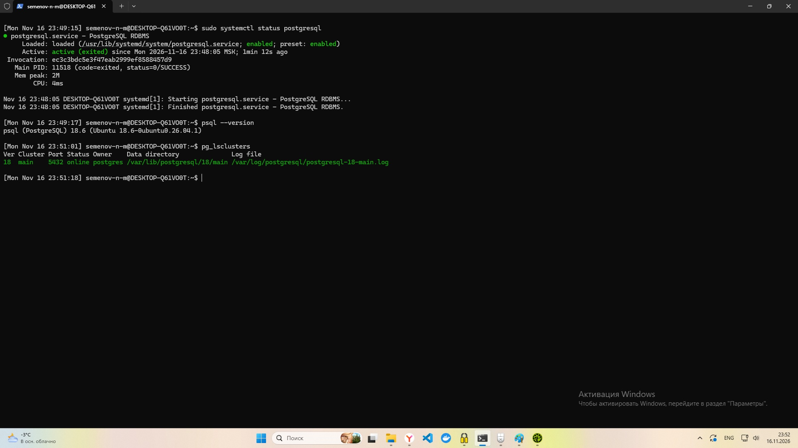

*Рис. 16. Версия psql 18.6; кластер 18/main в статусе online, порт 5432.*

### 3.4. Создание пользователя и базы данных

```bash
sudo -u postgres psql -c "CREATE USER semenov_n_m WITH PASSWORD 'password123';"
sudo -u postgres psql -c "CREATE DATABASE semenov_db OWNER semenov_n_m;"
```

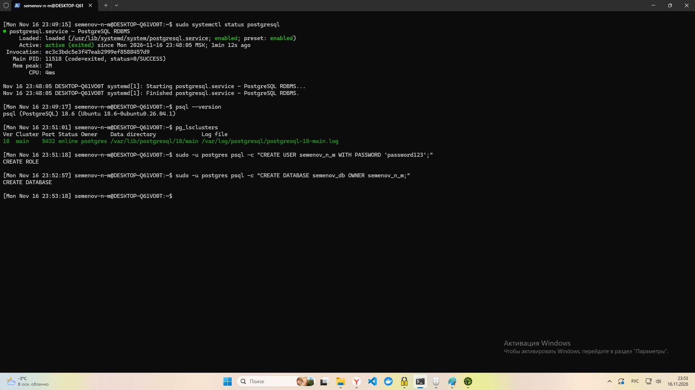

*Рис. 17. Создание роли semenov_n_m и базы semenov_db.*

Проверка списка БД и ролей:

```bash
sudo -u postgres psql -c "\l"
sudo -u postgres psql -c "\du"
```

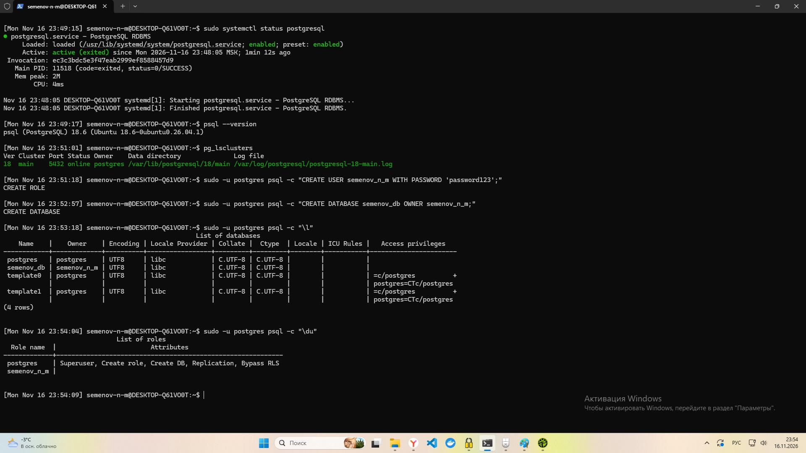

*Рис. 18. Список баз данных (semenov_db) и ролей (semenov_n_m).*
